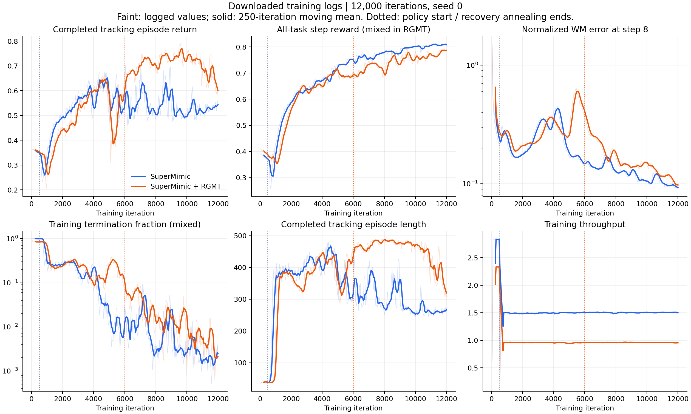

# SuperMimic 与 SuperMimic + RGMT：本次训练对照

分析日期：2026-10-29。本文中的 RGMT 指本项目的时序编码、cross-attention 和恢复课程组合，配置为 `rgmt_recovery`。

**结论：本次模型在独立站立恢复任务上明显改善；关节角误差有所下降，但完整动作跟踪的完成率和平均回报没有提升，抗推表现也没有一致优势。训练耗时增加约 54%。现有结果不能证明未见高动态动作的泛化能力提高。**

对照来自两个训练 run，各只有一个训练 seed。除了读取日志，我补做了最终模型的 CPU/MuJoCo 仿真评估，未使用本机 GPU，也未修改训练配置或原始日志。训练使用的后端是 mjwarp，因此以下物理评估还需要在服务器的相同后端复核。

## 1. 对照对象与参数

| 项目 | 普通版 | RGMT 版 |
| --- | --- | --- |
| run | `runs/supermimic_l40_001` | `runs/rgmt_recovery_seed0` |
| 评估模型 | `ckpt_012000.pt` | `ckpt_012000.pt` |
| 训练 seed | 0 | 0 |
| 训练迭代 | 12,000 | 12,000 |
| 实际采样步数 | 123,142,144 | 123,142,144 |
| 训练动作文件列表 | 40 段 | 相同 40 段 |
| 并行环境数 | 4,096 | 4,096 |
| 历史观测长度 | 10 | 10 |
| 参考窗口 | 10 帧未来参考 | 前 10 帧 + 当前帧 + 后 10 帧 |
| 策略编码 | MLP，拼接展平历史 | 因果历史编码 + cross-attention |
| 注意力参数 | 无 | 128 维、4 heads、1 层 |
| 恢复课程 | 无 | 开启；重置概率 15%，每次 3 秒 |
| 恢复辅助力 | 无 | 上限从 200 N 退火至 0，第 6,000 轮结束退火 |
| policy 可训练参数量 | 9,116,477 | 3,713,309 |
| checkpoint 记录的训练耗时 | 2 小时 15 分 | 3 小时 27 分 38 秒 |

学习率 `2e-4`、世界模型隐藏层 `[2048,2048,2048]`、策略解码层配置 `[2048,1024,512,256]`、critic `[256,128]`、想象 horizon=32、世界模型窗口=8、WM batch=2048、policy batch=4096、前 500 轮仅训练世界模型等设置相同。两组训练均记录为 mjwarp/CUDA，AMP 为 bf16。

RGMT 的 policy 参数量减少 **59.3%**，主要因为历史信息先被编码压缩，动作解码器的输入改变。参数更少没有带来更快的训练：注意力及其在可微 rollout 中的反向传播增加了计算。恢复任务也改变了训练内容，因此不能把全部额外耗时单独归因于注意力。

这里控制了总迭代和总仿真样本量，**没有控制总训练时间或纯跟踪样本量**。普通版缺少 RGMT run 中新增的动作文件内容哈希清单，只能确认记录的文件列表相同，不能追溯证明服务器两次使用的每个动作文件字节完全相同。

## 2. 训练日志：哪些指标变好了

两份 CSV 各有 240 条记录，每 50 轮一次，均覆盖到 12,000 轮，无缺失轮次及非有限数值。为减少单点波动，下表取最后 1,000 轮，即 `11000 < iteration <= 12000` 的 20 个日志点均值。

| 指标 | 普通版 | RGMT 版 | 解读 |
| --- | ---: | ---: | --- |
| `ep_ret_norm` | 0.5307 | 0.6529 | 已结束跟踪 episode 的归一化回报提高 23.0% |
| `ep_len` | 261.5 | 370.7 | 已结束跟踪 episode 更长，增加 41.8% |
| `sim_rew` | 0.8082 | 0.7767 | 全部训练步平均奖励下降 3.9%；RGMT 混入恢复任务 |
| `term_frac` | 0.204% | 0.449% | 记录值更高，但混入恢复 episode 的结束事件，不宜直接作跟踪失败率对比 |
| `wm_loss` | 0.05985 | 0.06858 | RGMT 的归一化世界模型训练损失更高 |
| `wm_err8` | 0.09598 | 0.10865 | RGMT 的归一化 8 步预测误差更高 |
| `imag_rew` | 0.8418 | 0.8047 | 想象 rollout 奖励更低，任务组成不同 |
| `imag_survival` | 0.9994 | 0.9857 | RGMT 恢复任务有固定结束时刻，不能仅据此判断更易跌倒 |
| CSV `it_per_s` | 1.506 | 0.955 | 每秒迭代数下降 36.6% |

`ep_ret_norm` 和 `ep_len` 在现有实现中排除了恢复 episode，但仍受自适应起始帧采样、episode 长度及结束 episode 的分布影响；日志先对每批结束的 episode 求均值，再汇总。这不是从每段动作第一帧开始的固定测试。

`term_frac` 是记录区间内终止事件数与全部结束事件数之比，统计范围与上述跟踪 episode 指标不完全相同；不能把它理解为每个仿真步的跌倒概率。世界模型误差使用各自运行中的输出归一化和数据分布，RGMT 增加了恢复状态，所以误差数字变大也不能直接证明在同一组物理状态上的预测能力变差。

TensorBoard 最后 1,000 轮逐轮计时显示，普通版每轮约 **0.657 秒**，RGMT 约 **1.038 秒**。采集部分为 0.231 → 0.298 秒，学习部分为 0.426 → 0.740 秒，额外开销主要在学习部分。CSV 吞吐量还受到区间内其他开销影响，数值略有差异。



## 3. 完整动作跟踪：没有整体胜出

评估两组最终 checkpoint，在 CPU/MuJoCo 中各运行同一份 40 段训练动作，每段从第一帧开始，一直运行至动作结束或失败。关闭观测、动作噪声、外推力和恢复辅助力；正常跟踪保持各模型保存的参考窗口。以下均为按 clip 等权汇总。

| 指标 | 普通版 | RGMT 版 | 结果 |
| --- | ---: | ---: | --- |
| 完成动作数 | 39/40（97.5%） | 37/40（92.5%） | 本次 RGMT 少完成 2 段 |
| 完整动作归一化回报 | 0.8187 | 0.8012 | RGMT 下降约 2.1% |
| 对齐后的身体位置误差 | 34.572 mm | 34.583 mm | 基本持平 |
| 关节角平均绝对误差 | 0.1021 rad（5.85°） | 0.0897 rad（5.14°） | RGMT 下降约 12.1% |
| 世界坐标身体速度误差 | 0.2201 m/s | 0.2257 m/s | RGMT 略高 |

完整动作回报以整段目标长度归一化，提前失败会被惩罚；位置、关节和速度误差只统计实际执行到的帧，**不对失败后的剩余帧填充惩罚**。RGMT 提前失败的动作更多，因此较低的关节误差是局部质量改善的迹象，不能单独用来证明整个任务更好。

位置误差对齐了根节点 XY 与航向，不等同于全局路径误差。原始结果也保留了世界坐标根节点误差：按 clip 均值为 1.226 → 1.197 m，按实际执行帧加权则为 1.229 → 1.240 m，口径改变会影响方向，未将其作为主要改善证据。

普通版失败：`fallAndGetUp2_subject3`。

RGMT 失败：`fallAndGetUp1_subject5`、`fallAndGetUp2_subject2`、`fallAndGetUp2_subject3`。

40 段中，RGMT 有 13 段归一化回报更高。差异最大的两段下降为 `fallAndGetUp2_subject2`（0.7404 → 0.1152）和 `fallAndGetUp1_subject5`（0.7537 → 0.5513）。另一方面，两者都失败的 `fallAndGetUp2_subject3`，RGMT 回报更高（0.4561 → 0.6758）。这说明不能只选择某一段动作来代表整体效果。

## 4. 独立站立恢复：改善最明确

使用三个**评估 seed**（0、1、2），每个 seed 各 32 个随机初始状态，共 96 次。两策略在每个 seed 下的初始物理状态逐项一致，已通过 tensor 和 SHA256 校验。每个任务持续 3 秒，辅助力为 0。

初始姿态随机选择 roll/pitch 轴，旋转角度覆盖 `[-π,π]`，关节在默认站姿附近扰动 ±0.15 rad；高度由身体最低点计算，初始速度为 0。此集合包括直立、小倾斜和严重翻转状态，不能把所有 96 次都称为“从平躺起身”。

成功要求在截止时刻之前连续 0.3 秒满足：根节点高度距 0.76 m 小于 0.12 m、倾斜小于 0.3 rad、相对默认姿态的关节 RMS 小于 0.5 rad、根节点线速度和角速度模长分别小于 0.5 m/s、0.5 rad/s。

| 评估 seed | 普通版成功次数 | RGMT 成功次数 |
| --- | ---: | ---: |
| 0 | 7/32 | 32/32 |
| 1 | 7/32 | 31/32 |
| 2 | 13/32 | 32/32 |
| 合计 | **27/96（28.1%）** | **95/96（99.0%）** |

按初始身体倾角分组：

| 初始倾角 | 样本数 | 普通版成功 | RGMT 成功 |
| --- | ---: | ---: | ---: |
| `[0°,30°)` | 13 | 13 | 13 |
| `[30°,90°)` | 33 | 14 | 33 |
| `[90°,180°]` | 50 | **0** | **49** |

严重翻转组同样表现出明显差异，结果不只是因为测试中存在接近直立的初始状态。恢复成功的样本首次达到稳定的平均时间为普通版约 1.19 秒、RGMT 约 1.04 秒，但两组成功样本不同，不据此判断谁起身更快。

**这是向固定站立参考恢复的任务。** 正常动作跟踪仍按参考时间推进，没有自动“检测跌倒 → 切换站立恢复 → 重新接入原动作”的状态机。因此，“更容易恢复站立”与“更准确跟随 fallAndGetUp 的整段轨迹”可以同时出现相反结果。测试也没有证明运行中任意跌倒后的自动续接能力。

## 5. 推力与参考噪声：暂未见一致优势

另用每段动作起始 10 秒进行短窗口配对测试。40 段的初始物理状态一致，推力施加时两组均有 40 个有效轨迹。推力在第 1 秒施加到骨盆，世界坐标 ±X、±Y 各 200 N，持续 0.2 秒；每个方向独立重置。参考噪声是现有评估器定义的逐特征均匀噪声，强度系数为 1，seed=0；两种策略的参考维度不同，因此噪声分布相同，不能称为逐元素相同噪声。

| 条件 | 普通版存活/完成 | RGMT 存活/完成 | 普通版窗口回报 | RGMT 窗口回报 |
| --- | ---: | ---: | ---: | ---: |
| 无扰动 | 40/40 | 40/40 | 0.9321 | 0.9327 |
| 推力 +X | 40/40 | 40/40 | 0.8286 | 0.8418 |
| 推力 -X | 40/40 | 39/40 | 0.8276 | 0.8377 |
| 推力 +Y | 40/40 | 40/40 | 0.8402 | 0.8331 |
| 推力 -Y | 40/40 | 40/40 | 0.8336 | 0.8474 |
| 参考噪声 | 40/40 | 40/40 | 0.9210 | 0.9270 |

四个推力方向合计普通版 160/160，RGMT 159/160；这个测试没有显示更好的抗推存活率，也不足以证明 RGMT 显著更差。部分方向的回报更高，部分更低。噪声使普通版回报下降约 0.0111，RGMT 下降约 0.0057，提示可能有参考噪声耐受收益，但这里只覆盖一个噪声等级和一个评估 seed，不能推广为全面抗扰提升。

## 6. 日志异常与证据边界

`rgmt_diagnostics.jsonl` 的 240 个 `recovery_success` 记录全部为 0，与上述 CPU 独立恢复结果不一致。该字段记录最近一批结束的恢复任务的均值，并非整个训练期间的累计成功率。

我在本地用最终模型额外核对了恢复判据和 transition 输出：当前 CPU 路径能够正确产生非零恢复成功记录，没有复现出“必然记录为 0”的问题。因此**没有将其认定为已定位的日志 bug，也没有修改相关训练代码**。训练中的随机化、采样分布、仿真后端及服务器实际代码版本都有待对照，当前无法确定原因。应先在服务器 mjwarp 后端重做相同配对评估，再区分日志记录问题和训练/评估条件差异。

恢复低高度样本也是值得后续检查的区域：最后 1,000 轮诊断中，根节点低于 0.45 m 的恢复样本，多步世界模型归一化误差约 1.734；较高样本约 0.051。同一 RGMT run 内这个差异提示世界模型对低高度恢复区域拟合较弱，但高度只是分组代理，不能据此定位为某一接触模型 bug。

其他限制：

- 两个模型都只有训练 seed=0；三个恢复评估 seed 不等于三次独立训练。
- 全部 40 段跟踪评估都来自训练列表，没有独立未见动作集合，不能证明泛化提升。
- 同时修改了网络、参考窗口和恢复任务，没有 encoder-only、recovery-only 或相同窗口 MLP 对照，不能将恢复收益或跟踪损失完全归因于某个模块。
- 这是 CPU/MuJoCo 的条件对照，不能替代服务器 mjwarp 或实机验证；本地评估的运行时长也没有用作训练速度对比。
- RGMT 日志记录的 PyTorch 峰值 allocated memory 约 31.65 GiB；普通版缺少对应记录，不能比较显存收益，也不能把该值当作 GPU 总显存占用。

## 7. 建议的下一步

1. **先复核，不急着重训。** 在服务器用原来的 mjwarp 后端评估这两个最终模型，重点复核恢复成功率和上述三段失败动作。
2. 按已有设计补齐普通版、相同 21 帧窗口 MLP、仅 RGMT 编码、仅恢复课程、完整组合的对照；先明确是哪个修改影响跟踪，再调整容量、恢复采样比例或损失。
3. 准备与训练严格分开的未见动作集合，分别统计一般动作和高动态动作，并补充多个训练 seed。若要主张训练效率，应同时报告相同训练时间预算的结果。

当前最有依据的表述是：**“融合版本显著增强了本次无辅助站立恢复任务的成功率，但完整动作跟踪存在取舍，尚未证实高动态泛化及整体抗扰提升。”**

## 8. 数据与复现

本地评估代码版本：`dbe42f9d9a3b627df4b4446333edcb16de9cb59d`；本次新增内容仅为分析脚本、报告、汇总和图表。

- [训练参数与日志汇总](training_summary.json)
- [逐动作、逐恢复初始状态及扰动评估汇总](evaluation_summary.json)
- [评估对比图 PNG](evaluation_comparison.png) / [PDF](evaluation_comparison.pdf)
- [训练曲线 PNG](training_curves.png) / [PDF](training_curves.pdf)
- 原始补充评估 JSON：`runs/comparison_rgmt_vs_baseline/`，与下载的两组训练日志分开保存。

以下命令均从仓库根目录执行，使用已安装的依赖和已有资产。重新执行将覆盖对应的分析输出，不会修改训练日志或模型。

```bash
# 本地 CPU：完整动作跟踪 + 96 次配对恢复。
CUDA_VISIBLE_DEVICES='' HF_HUB_OFFLINE=1 uv run --no-sync python \
  docs/experiments/rgmt_vs_baseline_2026-10-29/full_eval.py

# 本地 CPU：10 秒窗口推力/噪声对照。
CUDA_VISIBLE_DEVICES='' HF_HUB_OFFLINE=1 uv run --no-sync python \
  docs/experiments/rgmt_vs_baseline_2026-10-29/short_eval.py

# 从日志和上述 JSON 重新生成汇总、PNG 与 PDF。
CUDA_VISIBLE_DEVICES='' MPLCONFIGDIR=/tmp/rgmt-mpl uv run --no-sync python \
  docs/experiments/rgmt_vs_baseline_2026-10-29/analyze_logs.py
```

服务器复核命令如下；需要服务器上也有两个 run 的配置、最终 checkpoint、动作与机器人资产。本次未执行此 GPU 命令。

```bash
CUDA_VISIBLE_DEVICES=0 uv run --no-sync python \
  docs/experiments/rgmt_vs_baseline_2026-10-29/full_eval.py \
  --backend mjwarp --device cuda:0 \
  --output runs/comparison_rgmt_vs_baseline_mjwarp
```

配对恢复脚本会先初始化环境，再进行指定 seed 的重置，并校验两组初始状态哈希。这样避免将环境首次初始化时的随机状态误认为已按指定 seed 配对。
