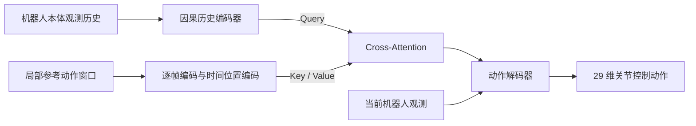

# Uni-SuperMimic 融合 RGMT：实现思路

日期：2026-10-27

状态：2026-10-29 已实现首版训练与评估链路，并补齐续训课程进度、外力重置边界和视频回放兼容性。使用方法见 [RGMT 训练与评估](rgmt_usage.md)。本文保留设计依据；本地验证使用 CPU/MuJoCo，完整训练效果与 GPU 性能留到服务器确认。

## 1. 目标与范围

在现有 Uni-SuperMimic 上引入原版 RGMT 的时序编码、状态条件 cross-attention 和跌倒恢复课程，训练一个兼顾多动作跟踪、未见动作泛化和受扰恢复的 policy，同时保留 SuperMimic 的可微世界模型训练方法。

核心组合为：

> SuperMimic 的训练方法 + RGMT 的参考动作编码 + 与世界模型一致的恢复课程。

SuperMimic 在学习到的世界模型中展开轨迹，并通过该轨迹反向传播更新策略。组合方案继续采用这一训练方法，收益以实际跟踪效果和计算开销衡量。[SuperMimic 方法说明](https://supermimic.github.io/)

第一版范围已经确认：

- 使用当前 G1 机器人、仿真后端体系和运动数据接口。
- 引入因果历史编码器和状态条件参考动作编码器。
- 加入恢复课程，并适配回放数据、世界模型输入、奖励与终止逻辑。
- 保留原始 SuperMimic 配置作为基线，提供可分别开启的实验配置。
- 完成仿真中的跟踪、泛化、扰动和恢复评估。

用户提供的 `/home/qihang/paper-2026/GMT/RGMT.pdf` 实际为 **Extreme-RGMT: Continual Learning of Highly Dynamic Skills for Robust Generalist Humanoid Control**。本阶段以原版 [Robust and Generalized Humanoid Motion Tracking](https://arxiv.org/abs/2601.23080) 为机制来源；附件中的 FSQ、PACE、STAR 等扩展留待后续评估。SONIC 上层多模态编码器、PPO/DAgger 训练分支和实机部署也不属于本阶段交付。

这是一项方法融合。由于优化算法、动作接口和部分输入特征沿用 SuperMimic，结果应称为“SuperMimic + RGMT 机制”，而非原版 RGMT 的逐项复现。

## 2. 当前代码基础

以下为编写文档时核对的实现，路径均相对仓库根目录。

| 模块 | 当前实现 | 融合切入点 |
| --- | --- | --- |
| `rl/algos/supermimic/networks.py` | MLP 世界模型；MLP 参考编码器和动作解码器；critic | 增加可选 RGMT 风格策略及统一构造入口 |
| `rl/algos/supermimic/learner.py` | 仿真采集、世界模型训练、可微想象 rollout、策略与价值更新 | 接入新策略，传播恢复状态及逐步外力 |
| `rl/algos/supermimic/replay.py` | 存储状态、动作、动力学上下文、参考帧、episode 步数等 | 扩展恢复元数据及采样返回字段 |
| `rl/contracts/supermimic.py` | 环境和 learner 之间的 MDP 协议 | 明确参考窗口、恢复状态、外力及终止接口 |
| `tasks/motion_tracking/g1/supermimic/motion.py` | 50 Hz 动作库，构造展平的未来参考 | 支持带时间维度的局部参考窗口 |
| `tasks/motion_tracking/g1/supermimic/mdp.py` | 可微观测、奖励、硬终止、软终止 | 共享恢复任务语义和终止规则 |
| `tasks/motion_tracking/g1/supermimic/manager_terms.py` | 参考状态附近初始化、动作控制、动力学随机化、轨迹记录 | 恢复初始化、辅助力事件、状态记录 |
| `tasks/motion_tracking/g1/supermimic/evaluate.py`、`render.py` | 构造现有策略，进行全 clip 评估和视频输出 | 加载新策略，增加独立恢复及扰动评估 |
| `scripts/train_supermimic.py`、`sim2sim.py` | 训练入口、配置快照、结构与资产校验 | 新配置、checkpoint 兼容、未见动作评估入口 |

表中源码路径位于 `src/unisupermimic/` 下。配置位于 `src/unisupermimic/conf/supermimic/`。

当前默认历史长度为 10，未来参考为 10 帧；单帧观测 99 维、单帧参考 73 维。当前策略把参考展平后经 MLP 编码，再与展平的观测历史拼接。当前想象步长直接执行 `frames + 1`，并采用按参考高度和姿态偏差计算的软终止概率；恢复课程需要显式处理这些假设。

## 3. 策略网络方案

原版 RGMT 使用历史编码形成 query，再对局部参考窗口做 cross-attention；参考实现依据包括 10 步历史、128 维嵌入、因果注意力、时间最大池化及前后各 10 帧的参考窗口。[RGMT 网络结构](https://arxiv.org/html/2601.23080v1#S2.SS3)

### 3.1 本项目的建议实现

新增策略类型，例如 `RGMTPolicy`，与现有 `Policy` 共存，通过策略工厂选择。

1. **历史编码**：逐帧 MLP、时间位置编码、轻量因果 Transformer、时间池化，得到当前动力学表征。
2. **参考编码**：每帧单独编码，加入相对参考时刻的位置编码，保留时间顺序。
3. **Cross-attention**：动力学表征产生 query，参考 token 产生 key/value，输出当前控制所需的参考表征。
4. **动作解码**：参考表征与当前观测融合，经 MLP 输出现有动作接口所需的 29 维动作。

历史分支建议使用现有观测中的 93 维本体部分，包括关节状态、角速度、重力方向和上一动作；当前 99 维观测中的另外 6 维是相对参考朝向，保留给当前观测分支，避免混淆本体历史与参考信息。该拆分属于本项目适配方案。

第一版参考特征建议沿用 SuperMimic 的 73 维表示，减少同时改变的因素。原版 RGMT 的 38 维参考表示可作为后续独立对照。动作仍使用当前默认姿态、关节偏置和动作缩放构造 PD 目标；切换为参考姿态残差控制会改变世界模型的动作语义，应另作实验。

### 3.2 参考窗口与时间语义

- 建议窗口为 `[t-10, ..., t, ..., t+10]`，共 21 帧，在当前 50 Hz 控制频率下前后各覆盖 0.2 秒。
- 在当前 clip 内对越界索引做边界填充，保证不会读取相邻 clip；位置编码对应所请求的时间偏移。
- 各帧特征继续采用明确、一致的坐标系，并与原有特征定义对齐。
- 历史观测只来自当前及过去的机器人状态；episode 重置后独立填充历史，不能混入上一 episode。
- 仿真采集、想象 rollout、评估和视频使用同一套特征生成逻辑。

Cross-attention 提供自适应特征聚合，第一版正常跟踪仍按固定参考时间推进，并保留逐时刻跟踪奖励。自主调整参考相位属于独立研究方向。离线动作可以使用未来参考；若以后接实时遥操作，需要另行设计缓冲延迟或因果窗口。

### 3.3 与可微训练的衔接

想象 rollout 内，新预测状态生成观测并更新历史，梯度应能经过观测、历史编码器、cross-attention、动作和世界模型回到策略参数。冻结世界模型参数时仍须保留对状态和动作输入的梯度。

检查归一化、混合精度及 attention 实现是否支持这条梯度路径，避免误用 `detach()` 或推理专用路径。critic 初期沿用现有结构，按新的参考维度重建输入；引入恢复任务后再补充必要的任务状态。

## 4. 跌倒恢复课程

原版 RGMT 在部分环境中使用随机不稳定姿态初始化、逐渐退火的向上辅助力，以及暂时关闭失稳提前终止的恢复窗口。论文给出的起点是 15% 恢复环境、3 秒窗口、初期 0–200 N 辅助力。[RGMT 恢复课程](https://arxiv.org/html/2601.23080v1#S2.SS4)

本项目建议把这些数值作为可配置的实验起点，而非效果保证。

### 4.1 恢复任务定义

训练环境混合普通跟踪 episode 与恢复 episode，同一个 policy 接收对应参考并产生动作。初始化难度从轻度失稳逐渐扩展到侧倒、仰卧、俯卧等姿态；避免初始化穿透地面造成数值异常。

**首版采用站立参考恢复。** 静止参考使用固定站立姿态及零参考速度；追加的静止 clip 的时间索引编码剩余恢复时间，因此无需在 replay 冗余存储相同计时信息。跌倒后切换参考、恢复后接续原相位的运行时状态机留待后续实现。

恢复参考的世界坐标位置和朝向应与 episode 的初始化区域对齐；其选择方式、参考帧推进或保持方式、恢复成功后的行为，都必须由环境和想象 rollout 共享。不能一边等待起身，一边让参考时间继续推进到完全不同的高动态动作。

### 4.2 奖励、终止与辅助力

- 普通跟踪继续使用原有奖励与终止设置。
- 恢复窗口内暂时屏蔽相关失稳终止，数值异常仍需及时结束。
- 成功标准建议结合目标姿态、高度、速度和持续稳定时间；具体阈值待实测确定。
- 恢复窗口结束后按统一的成功或失败规则处理。普通跟踪中的低姿态、翻滚等合法动作不得直接按站立高度判失败。
- 初期优先复用跟踪奖励；若远离目标时奖励与梯度过弱，再为恢复阶段增加可微的姿态、高度或速度引导项，并单独记录其影响。
- 辅助力的施加部位、方向、持续时间和退火日程必须明确；评估时关闭辅助力。

恢复到站立和恢复后接续原动作是两个不同验收项目。只有第二项验证通过，才能声称支持连续跟踪中的完整恢复。

## 5. 世界模型与恢复课程的关键适配

这是融合方案中最需要验证的部分。新增策略编码器本身不能解决世界模型对倒地、支撑切换和起身状态预测不准的问题。

### 5.1 训练数据覆盖

恢复轨迹与普通跟踪轨迹都进入 replay。世界模型分别记录正常跟踪、倒地接触、起身过程的单步和多步误差，避免整体平均误差掩盖恢复状态预测失败。

必要时给恢复样本保留采样配额，并记录实际采样比例。恢复 curriculum 初期应先积累相关仿真数据，确认世界模型能预测这些状态，再加大恢复任务的策略更新比例。

### 5.2 区分动力学输入与任务状态

| 数据 | 用途 |
| --- | --- |
| 实际施加的辅助力或外部力/力矩，以及固定的施力位置约定 | 世界模型预测下一状态的已知动力学条件 |
| 恢复标记、剩余恢复步数、参考推进模式 | 参考更新、奖励、硬/软终止及 critic 的任务条件 |
| episode 步数、结束原因、边界标记 | 回放序列有效性、历史重建与 bootstrap 处理 |

辅助力改变了真实状态转移，不能仅在物理仿真中施加，却让世界模型只看到原来的状态和动作。建议保留现有动力学上下文 `xi` 的含义，新增逐步外力输入；普通样本对应零外力。世界模型可以知道训练中的辅助力，actor 使用部署时可获得的观测。

回放记录历史 transition 实际使用的外力；拟合历史数据时不能用当前训练迭代的退火值覆盖它。想象 rollout 则使用显式选定的外力初值和日程，并随步数更新。

### 5.3 同步环境与想象 rollout

当前 `sample_starts()` 没有返回恢复计时等信息，想象过程也没有恢复任务状态。需要同步扩展协议、环境状态快照、transition、回放窗口和 rollout 状态传递。

关键约束如下：

- 恢复宽限期内，硬终止与软终止采用同样的豁免规则；剩余时间逐步递减。
- critic 获得影响后续收益的恢复阶段和剩余时间，区分“还能尝试恢复”与“即将超时”。
- 参考推进通过统一接口完成；恢复保持参考时，不能继续无条件执行 `frames + 1`。
- 恢复终止、普通失败、时间截断和 clip 结束分别定义 bootstrap 语义，避免把 reset 后的状态当作前一 episode 的真实后继。
- `valid_imagination_start()` 同时考虑参考模式、clip 边界及恢复窗口；没有足够合法起点时应给出明确处理，避免持续重采样。

当前默认想象长度为 32 步，即 0.64 秒，短于建议恢复窗口。初期依靠多起点训练和 critic 估计后续收益，并检查是否能学到完整起身过程；需要延长 horizon 时，同时评估多步模型误差和训练开销。

如果恢复表现不佳，先检查恢复数据覆盖、外力条件和多步预测误差，再决定采样、horizon 或模型容量调整。组合后的性能与效率不能仅由两篇论文分别有效推断得到。

## 6. 配置、checkpoint 与评估入口

采用可选模块配置，避免复制整套 learner。策略构造入口由训练、评估、视频和交互播放共用，防止出现训练成功但 checkpoint 无法加载的情况。

| 配置项 | 第一版建议 | 性质 |
| --- | --- | --- |
| 策略类型 | `mlp` / `rgmt` 可选 | 工程设计 |
| 历史长度 | 10 | 沿用现有默认 |
| RGMT 参考窗口 | 前 10 帧 + 当前帧 + 后 10 帧 | 参考论文的起点 |
| token 维度 | 128 | 参考论文的起点 |
| 历史注意力层数、head 数 | 1 层、4 heads | 本项目建议，待验证 |
| RGMT 路径参考特征 | 现有 73 维特征 | 适配选择 |
| 恢复样本比例与窗口 | 0.15、3 秒 | 参考论文的起点 |
| 辅助力 | 可关闭，最高幅值与退火日程可配 | 参数需结合后端验证 |
| 世界模型宽度、学习率、rollout 长度 | 首轮沿用当前配置 | 控制变量 |

checkpoint 和配置快照记录策略类型、输入特征版本、参考窗口、网络维度、外力接口、恢复课程进度及数据划分身份。旧 checkpoint 按原 MLP 路径加载；新旧策略之间不使用静默的部分参数加载。正式消融优先独立训练，预训练权重迁移另行报告。

当前严格 sim2sim 校验把 motion 文件列表也作为一致性条件。未见动作评估需提供明确的“更换参考数据”入口：允许更换 motion 清单并记录新身份，同时继续验证机器人、关节顺序、动作语义和特征结构；不能靠关闭全部严格校验完成。

## 7. 分阶段实施与验收

| 阶段 | 工作 | 验收条件 |
| --- | --- | --- |
| A：基线与接口 | 固定基线配置、数据划分与指标；整理策略工厂 | 原 MLP 路径训练、加载、评估行为通过回归检查 |
| B：只加编码器 | 局部参考窗口、因果历史编码、cross-attention、推理入口 | 短训练可运行，梯度贯通，评估与视频可加载新模型 |
| C：恢复环境与模型数据 | 恢复初始化、参考语义、辅助力、计时、回放字段 | 状态与外力记录正确，恢复多步模型误差可单独测量 |
| D：恢复策略训练 | 软终止、critic、参考推进、采样与课程衔接 | 仿真和想象规则一致，可评估无辅助恢复成功率 |
| E：完整实验 | 四组消融、未见动作、扰动测试、效率统计 | 输出同协议下的指标、曲线及典型成功/失败视频 |

阶段划分是开发顺序，不要求最终训练必然采用多阶段预训练。第一步实施建议从 A、B 开始。

## 8. 实验与验证

### 8.1 基本消融

| 实验 | RGMT 风格编码器 | 恢复课程 |
| --- | --- | --- |
| 原始 SuperMimic | 关闭 | 关闭 |
| SuperMimic + 编码器 | 开启 | 关闭 |
| SuperMimic + 恢复 | 关闭 | 开启 |
| 完整融合 | 开启 | 开启 |

这四组衡量模块整体贡献。由于新编码器同时改变了参考窗口，如需把收益进一步归因于 cross-attention，应增加接收相同窗口的 MLP 对照，并在需要时加入仅历史编码的对照。

各组固定机器人、数据划分、训练后端、奖励和评估协议；报告相同计算预算下的效果，以及达到同一目标效果所需的时间。正式结果建议至少运行 3 个随机种子，同时统计训练吞吐、峰值显存和策略推理耗时。

### 8.2 数据与指标

先用现有 LAFAN1 数据验证接口和训练，再补充有代表性的跳跃、旋转、起落及地面接触动作。扩充数据后基线也应在同一训练集上重训。

训练、验证、测试按完整原始动作序列分组；同一来源序列的裁剪、重定向或增广版本不能跨集合。若某动作已经用于世界模型训练，也应视为该系统见过的数据，不能作为严格的未见测试。

| 测试 | 核心指标 |
| --- | --- |
| 无扰动全 clip 跟踪 | 完成率、归一化回报、跟踪误差 |
| 未见动作与高动态子集 | 分组完成率、姿态/关节位置误差、速度误差 |
| 参考输入噪声 | 固定噪声等级下的误差与失败率 |
| 外部推扰 | 固定方向、幅值、时机下的完成率及重新稳定时间 |
| 随机倒地初始化 | 无辅助恢复成功率、恢复时间、恢复后稳定性 |
| 受扰后接续动作 | 恢复后能否继续跟踪及剩余 clip 完成率 |
| 训练与模型质量 | GPU 时间、峰值显存、吞吐、分状态类别的模型误差 |

跟踪误差需固定身体点集合、坐标对齐方式和有效帧口径，并与失败率一起报告，避免提前终止掩盖大误差。主要指标在物理仿真中评估，想象回报只作训练诊断。

正常跟踪测试使用统一的失败标准；恢复测试使用统一的恢复窗口，两者分别统计，避免仅靠放宽终止条件提高完成率。所有正式恢复测试关闭辅助力，扰动日程与初始状态使用固定测试种子。

### 8.3 实现时需要的验证

- 网络：输入输出形状、因果 mask、reset 历史、跨世界模型的梯度及混合精度稳定性。
- 参考窗口：clip 首尾、短 clip、坐标系一致性及同窗口对照。
- 恢复与回放：实际外力记录、计时推进、跨 episode mask、硬/软终止一致性。
- 集成：短训练、保存/加载、续训、独立评估、视频及未见动作入口。
- 回归：原始 MLP 配置与旧 checkpoint 的已有测试。

恢复辅助力先在 MuJoCo 后端验证，再逐个核对其余后端能力。缺少能力时显式报错或选择无辅助配置，不能静默忽略外力。首版已增加数值测试和真实后端短程训练测试。

## 9. 首版选择与后续实验

| 项目 | 当前建议 |
| --- | --- |
| 恢复目标和参考推进 | 静止站立 clip，固定窗口结束，普通跟踪的参考时序保持连续 |
| 成功判据和奖励 | 可配置的姿态、高度、关节、速度和持续稳定阈值；默认保留原跟踪奖励 |
| 课程与辅助力日程 | 倾斜角线性加难，辅助力按 reset 时的课程进度采样；iteration 随 checkpoint 恢复 |
| 数据清单和评估预算 | 已提供分组 manifest、内容哈希和未见集合检查；正式数据与 GPU 预算待实验确定 |
| 首个恢复后端 | 已验证 MuJoCo 外力、训练及评估；其他后端使用同一接口但仍需运行验证 |

正式实验仍需确认高动态数据覆盖、模型多步预测误差、无辅助恢复效果和训练成本。短程测试只证明代码链路可运行，不代表已复现论文性能。
